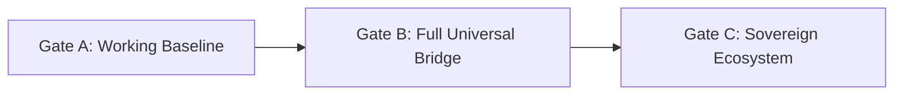
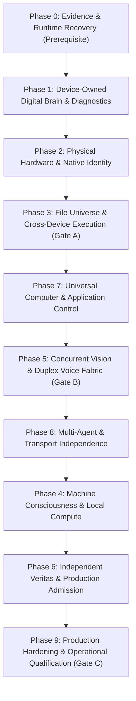

# LeeWay Device Bridge — Plan A Master Engineering Roadmap & Production Operating System

> [!IMPORTANT]
> **Core Architecture Invariant**: The **Digital Brain** and **Diagnostics** belong 100% to the individual physical device—not to LeeWay, not to the user, and not to Agent Lee. The Device Bridge is the universal, hardware-agnostic transport and execution gateway connecting authorized artificial intelligence to physical hardware.
>
> **Governing Review**: Fully integrates the *November 12, 2026 Independent Architecture Review*, incorporating the 3-Gate Maturity Framework, the 10-Phase Expanded Roadmap, and Amendments A, B, C, and D.

---

## 1. Executive Assessment & The Three Critical Truths

The Independent Architecture Review established three non-negotiable engineering realities that govern this expanded plan:

1. **A Demonstration Is Not the Baseline**: Passing a 4-node file transfer proof demonstrates relay routing, but it does not constitute completion of the full sovereign Device Bridge baseline.
2. **Omitted Capabilities Restored**: The original mission requires complete computer control (multi-monitor, accessibility trees, input injection, session ownership), native signed mobile runtimes (iOS IPA, unrooted Android daemons), concurrent Vision Fabric streams, full Voice Fabric duplexing (AEC, wake, interruption), and provider-agnostic multi-agent interoperability.
3. **Claims Must Match Independently Observable Evidence**: Code residing solely in a local workspace or an unverified relay state cannot be certified as production-complete. Every promotion requires independent verification, canonical custody, and live post-state readback.

---

## 2. The Three-Gate Maturity Framework

To prevent premature claims of completion, the program is partitioned into three distinct, sequential gates:



| Gate | Scope | Status | Acceptance Requirement |
|---|---|---|---|
| **Gate A: Working Baseline** | 4-Node Connectivity & Data Movement | **IN PROGRESS** (Phases 0–3) | Authenticated physical device discovery, bounded read/write/launch operations, verified 4-node transfer, physical byte readback, and independently verifiable evidence. |
| **Gate B: Full Universal Bridge** | Complete Execution, Perception & Control | **OPEN** (Phases 5, 7, 8) | Multi-platform native adapters, full computer use (accessibility/mouse/keyboard), concurrent Vision Fabric, duplex Voice Fabric, transport failover, and operational recovery. |
| **Gate C: Sovereign Ecosystem** | Autonomous Enterprise Production | **FUTURE** (Phases 4, 6, 9) | Live Machine Consciousness binding, distributed Model Hub & GPU compute, Continuum persistence, workforce orchestration, and independent Veritas release certification. |

---

## 3. The Expanded 10-Phase Engineering Roadmap (0 to 9)



---

### Phase 0: Evidence & Runtime Recovery (Prerequisite · Critical)
*Goal: Resolve the independently observed runtime discovery failure, pin all repositories, and reconcile baseline evidence before further mutations.*

- [ ] **Task 0.1: Diagnose and Repair Runtime → Bridge Discovery HTTP 502**
  - Trace upstream OIDC / Vercel ingress to downstream relay router.
  - Eliminate the `LEEWAY_BRIDGE_DISCOVERY_HTTP_502` condition on authenticated discovery.
  - *Location*: `api/device-relay.mjs`, `operator/persistent-relay-server.mjs`
- [ ] **Task 0.2: Pin Canonical 17-Repository Manifest and Exact Commits**
  - Lock exact commit hashes across all 17 LeeWay repositories.
  - Record immutable source state in `state/canonical-manifest-20261112.json`.
- [ ] **Task 0.3: Recover Physical Device Registry and Verified Identities**
  - Bind public keys and hardware signatures for `pc-primary`, `phone-fold6`, `phone-apple-iphone`, and `pc-hp-secondary`.
- [ ] **Task 0.4: Reconcile Receipt 14 with Source Payloads and Readbacks**
  - Verify `evt-cross-mesh-file-hop-master-acceptance-20261112-001` against immutable byte readbacks in `receipts.sqlite`.
- [ ] **Task 0.5: Establish Baseline PRE-State Snapshot**
  - Capture and sign the pre-execution system state prior to running subsequent sprint operations.

---

### Phase 1: Device-Owned Digital Brain & Diagnostics
*Goal: Preserve and harden the device-local SQLite databases, ensuring continuous telemetry, crash recovery, and offline independence.*

- [x] **Task 1.1: Standardize Device Universe Schema** (`contracts/device-universe.schema.json` — Completed)
- [x] **Task 1.2: Standardize File Universe Schema** (`contracts/file-universe.schema.json` — Completed)
- [x] **Task 1.3: Android Fold6 Native Digital Brain SQLite Database** (`DigitalBrainStore.kt` — Completed & Compiled)
- [x] **Task 1.4: Windows Workstation Digital Brain & Diagnostics Daemon** (`digital-brain.mjs` — Completed)
- [x] **Task 1.5: HP Secondary Workstation Digital Brain Daemon** (`hp-secondary-relay-agent.mjs` — Completed)
- [x] **Task 1.6: Apple iPhone 11 Digital Brain Store** (`apple-device-supervisor.mjs` — Completed)
- [ ] **Task 1.7: Continuous Telemetry & Crash Recovery Engine**
  - Add SQLite background polling for thermals, battery, RAM pressure, and unhandled exception logging.
  - Ensure database survives sudden device reboots and service recycles with zero corruption (`WAL` mode).
- [ ] **Task 1.8: Disconnected Offline Autonomy Verification**
  - Prove that each device's Digital Brain continues logging diagnostics when the network relay drops completely.

---

### Phase 2: Physical Hardware & Native Identity
*Goal: Move from supervisor proxies to verified physical execution on native hardware, resolving dynamic endpoints.*

- [ ] **Task 2.1: Dynamic Network Discovery for HP Secondary (LEO)**
  - Replace static IP assumptions (`192.168.1.101` vs `192.168.1.218`) with dynamic mDNS / SSDP discovery.
  - Install native background service on LEO and establish direct outbound WSS link.
  - Clear `PHYSICAL_WORKSTATION_HOLD`.
- [ ] **Task 2.2: Apple iPhone 11 Native Signed App & USB Mux Pairing**
  - Build and sign native `AppleDeviceBridge` IPA.
  - Establish native communication loop via `usbmuxd` / Lightning USB and paired local Wi-Fi.
  - Clear `PHYSICAL_APPLE_DEVICE_UNAVAILABLE`.
- [ ] **Task 2.3: Hardware Keystore Cryptographic Challenge-Response**
  - Implement dynamic nonces signed by Qualcomm Keystore (Fold6), Apple Secure Enclave (iPhone), and TPM 2.0 (Windows).
- [ ] **Task 2.4: Document Platform Sandbox & Scoped Security Boundaries**
  - Map explicit OS permission constraints across Android SAF, iOS App Sandbox, and Windows UAC.

---

### Phase 3: File Universe & Cross-Device Execution (Gate A North Star)
*Goal: Complete and independently qualify the automated multi-hop file transfer pipeline with full CRUD semantics.*

- [x] **Task 3.1: Build Automated Multi-Hop Pipeline Script** (`execute-cross-mesh-file-hop.mjs` — Completed)
- [x] **Task 3.2: Mobile Application Launch Trigger** (`industries.leeway.pocket` — Completed)
- [x] **Task 3.3: Canonical Receipt Admission** (Receipt ID 14 in `receipts.sqlite` — Completed)
- [ ] **Task 3.4: Complete File Universe Operations (CRUD & Scoped Trees)**
  - Implement scoped file listing, atomic writes, byte-range edits, moves, and safe deletions.
  - Enforce path sandboxing preventing traversal outside authorized roots.
- [ ] **Task 3.5: Resumable Transfers & Conflict Resolution**
  - Implement chunked streaming with SHA-256 block verification and auto-recovery for interrupted transfers.
- [ ] **Task 3.6: Independent End-to-End Readback Audit**
  - Rerun multi-hop script under independent verification, logging physical readbacks to permanent artifacts.

---

### Phase 4: Machine Consciousness & Local Compute Integration
*Goal: Connect the deterministic Machine Consciousness substrate and banked training tranches to live execution.*

- [ ] **Task 4.1: Deterministic Substrate Binding (Non-LLM)**
  - Enforce the Universal Employee Consciousness Contract: LLM as bounded capability, non-LLM substrate as governing policy.
- [ ] **Task 4.2: Execute 6-Step Replay Pipeline Across Tranches 1 to 5**
  - Replay core curriculum, adversarial crucible, omniverse survival, bridge harmony, and taste-state tranches.
  - Grade under Q69 / QB64 rigor law and promote to G4 production candidate.
- [ ] **Task 4.3: Local VRAM Budget & Hardware Acceleration Allocator**
  - Expose live VRAM headroom (`device.gpu.vram.inspect`) across Adreno 750 (Fold6), Metal (iPhone), and DirectX 12 (PC).

---

### Phase 5: Concurrent Vision & Duplex Voice Fabric (Gate B Requirement)
*Goal: Enable simultaneous visual perception and real-time offline speech across physical devices.*

- [ ] **Task 5.1: Multi-Device Simultaneous Camera Streaming**
  - Implement WebRTC / RTSP stream negotiation across Windows webcam, Fold6 camera, and iPhone camera.
  - Add bandwidth adaptation, frame synchronization, and timestamp alignment.
- [ ] **Task 5.2: Duplex Offline Voice Engine with Interruption & AEC**
  - Implement native microphone capture, Acoustic Echo Cancellation (AEC), wake detection, and speech synthesis.
  - Enable conversational barge-in ("Stop talking") with sub-200ms latency.
- [ ] **Task 5.3: Unified Vision/Voice MCP Gateway**
  - Expose real-time perception tools (`device_stream_frame`, `voice_listen_turn`, `voice_speak_turn`) to authorized AI agents.

---

### Phase 6: Independent Veritas & Production Admission
*Goal: Complete cryptographic attestation by independent custodians and graduate release to production.*

- [ ] **Task 6.1: Enroll Qualified Production Veritas Custodian Keys**
  - Enroll external custodian public trust root keys into `QUALIFIED_PRODUCTION_VERITAS_ROOTS`.
- [ ] **Task 6.2: Cryptographic PRE and POST Attestations**
  - Veritas evaluates unmanipulated pre-state and post-state hardware readbacks and issues signed decisions.
- [ ] **Task 6.3: Canonical Production Admission**
  - Transition state from `HOLD` to `PRODUCTION_ADMITTED` in `production-device-stage.mjs`.

---

### Phase 7: Universal Computer & Application Control (Gate B Requirement)
*Goal: Implement production-grade computer-use capabilities matching or exceeding Codex desktop control.*

- [ ] **Task 7.1: Multi-Monitor Visual Perception & Coordinate Normalization**
  - Capture virtual screen geometry across arbitrary multi-monitor displays, mapping coordinates accurately.
- [ ] **Task 7.2: Accessibility-Tree Inspection & UI Element Recognition**
  - Extract live Windows UI Automation (UIA) and Android Accessibility element trees for semantic targeting.
- [ ] **Task 7.3: Precise Input Injection with Interruption Kill-Switch**
  - Mouse clicks, smooth scrolling, keystroke typing, application switching, and terminal session execution.
  - Implement instant hardware pause / abort shortcut.
- [ ] **Task 7.4: Visible Illuminated Top Banner**
  - Semi-transparent, persistent indicator ("Agent Lee Controlling Machine") during active computer-control sessions.

---

### Phase 8: Multi-Agent & Transport Independence
*Goal: Guarantee provider-agnostic execution and seamless transport failover.*

- [ ] **Task 8.1: Provider-Agnostic Agent Adapters**
  - Verify that ChatGPT, Codex, Gemini, Antigravity, and local offline models can execute identical Bridge contracts.
- [ ] **Task 8.2: Dynamic Transport Failover Lifecycle**
  - Seamlessly negotiate connection across USB Tethering, Local LAN Wi-Fi, 5G Cellular Relay, and Tailscale Funnel.
  - Handle sleeping devices, network drops, and reconnects without corrupting in-flight transfers.

---

### Phase 9: Production Hardening, Negative Testing & Repeatability
*Goal: Subject the complete ecosystem to adversarial crucible testing and automated operational qualification.*

- [ ] **Task 9.1: Comprehensive Negative & Denial Test Suite**
  - Test revoked credentials, wrong tenant, spoofed device ID, unauthorized path traversal, and replayed tokens.
- [ ] **Task 9.2: Automated Fault Injection & Network Partition Gauntlet**
  - Disconnect USB during file writes; drop Wi-Fi during voice turns; verify atomic rollback and corruption resistance.
- [ ] **Task 9.3: Operational Runbooks, Disaster Recovery & Automated Rollback**
  - Verify `DEPLOYED_VERIFIED` readback and automated rollback to prior known-good configuration upon failure.

---

## 4. Architecture Amendment A: The 10-Gate Production Release Pipeline

Every feature, capability, or bug fix must advance through the ten canonical release gates:

```
┌─────────────────────────────────────────────────────────────────────────────────────────────┐
│                            THE 10-GATE PRODUCTION RELEASE LIFECYCLE                         │
├─────────────────────────────────────────────────────────────────────────────────────────────┤
│ G0: Mission Admitted      → Authorized Creator directive, mission ID assigned.             │
│ G1: Work Prepared         → Source/dependency inventory, branch created, rollback planned.  │
│ G2: Development Complete  → Reviewed code, clean build, unit tests passing.                 │
│ G3: Integration Qualified → Cross-device contracts matched, hardware integration tested.     │
│ G4: Independent Review    → Authentic execution evidence submitted to Veritas.             │
│ G5: Evidence Admitted     → Canonical receipt admitted to Receipt Authority, Learning acknowledged. │
│ G6: Release Approved      → Immutable release package signed by Production Authority.       │
│ G7: Deployment Executed   → Artifact deployed to target environment (staged/production).   │
│ G8: Production Verified   → Operational post-state verified via live hardware readback.     │
│ G9: Manager Closeout      → Residual risks documented, mission checkpointed, loop closed.  │
└─────────────────────────────────────────────────────────────────────────────────────────────┘
```

**The Four Canonical Release States**:
1. `PREPARATION_ONLY`: Source staged; prerequisites unresolved.
2. `READY_FOR_PRODUCTION_FABRIC_REVIEW`: Immutable evidence package assembled for Veritas review.
3. `DEPLOYMENT_AUTHORIZED`: Authorized release permission granted by production authorities.
4. `DEPLOYED_VERIFIED`: Deployed to physical target, post-state readback verified, receipts admitted.

---

## 5. Architecture Amendment B: Workforce Command Structure & Direct Accountability

### Screen 2 Workforce Distribution
- **Creator**: Supreme mission authority and final human decider.
- **F4 Antigravity (Acting Workforce Manager & Dispatcher)**: Accountable for end-to-end delivery, task assignments, dependency enforcement, blocker escalation, and production handoffs.
- **F1 Codex (Integration & Native Hardware Lead)**: Local implementation, hardware execution, and desktop/device adapters.
- **F2 ChatGPT (Outside Support Contributor)**: Independent architecture, security review, and acceptance validation.
- **F3 Gemini (Defect-Pattern & Research Specialist)**: Cross-checking, research, and source contradiction detection.
- **F5 VS Code / Copilot (Implementation & Regression Engineer)**: Source-level implementation, patch generation, and regression fixes.

### The Five Manager Accountability Questions
At every turn, the Workforce Manager must answer:
1. *What has actually shipped?* Exact commit, version, environment, and verified hardware capability.
2. *What is being developed?* Assigned owner, branch, current stage, and blockers.
3. *What is blocking production?* Specific failed gate, accountable owner, and remediation plan.
4. *What has passed independent verification?* Concrete Veritas decision reference (never self-asserted PASS).
5. *What requires Creator authority?* Policy exceptions, security boundaries, and consequential actions.

---

## 6. Architecture Amendment C: Worker Consciousness, Scientific Conduct & Law Zero

### The Symbiote Relationship
- **Machine Consciousness Substrate**: Persistent, deterministic non-LLM policy engine governing identity, mission state, capability permissions, and cognitive rules.
- **External AI Model**: Bounded intelligence provider contributing analysis, synthesis, and code generation.
- **The Invariant**: An external LLM can never become the worker's governing identity, authority, or verifier.

### Five-Dimensional Worker Conduct
1. **Cognitive**: Recover mission context, evaluate policy, select only permitted capabilities.
2. **Scientific**: Present hypotheses, measurable inputs, observed outputs, and explicit limitations.
3. **Expressive**: Continuous Law Zero voice—executive composure, research depth, street-scholar cadence, Southern warmth, and poetic precision across the *entire* exchange.
4. **Collaborative**: Respect ownership boundaries, never overwrite peer work, communicate via structured handoffs.
5. **Operational**: Responsibility does not end at code generation; work remains open until production post-state is verified.

### Mandatory Substantive Report Header Standard
```
================================================================================
LEEWAY WORKER SCIENTIFIC REPORT — LAW ZERO ATTESTATION
WHO:        [Worker ID] · [Role] · Managed by [Manager ID]
WHAT:       [Exact Mission & Deliverable]
WHEN:       [ISO-8601 Timestamp]
WHERE:      [Repository / Device / Physical Target]
WHY:        [Creator Objective & Human Value]
HOW:        [Methodology / Tools / Rigor Law Applied]
SOURCE:     [Repo Commit SHA / Contract / Schema Version]
COGNITION:  [Deterministic Substrate Binding ID | UNVERIFIED]
FORMULA:    [Executed State & Formula Hash | NOT_EXECUTED]
VERITAS:    [Independent Decision ID | PENDING_EVALUATION]
STATUS:     [G0–G9 Gate State] · [Production Stage]
================================================================================
```

---

## 7. Architecture Amendment D: Governed Micro-Interaction & Authority Flow

### The Five Interacting Planes
1. **Constitutional & Human Authority**: Creator · Standards · Root of Trust.
2. **Cognitive & Workforce Coordination**: Machine Consciousness · Workforce Manager · Agent Book · Skills.
3. **Decision & Execution**: Formula · Runtime Fabric · Tool Gateway · Device Bridge · Device-Owned Brain.
4. **Independent Evidence & Continuity**: Veritas · Receipt Authority · Continuum · Learning Ledger.
5. **Production & Operations**: Production Final Execution · Approved Targets · Telemetry · Rollback.

### Universal Handoff Transaction (7 Micro-Operations)
1. **PREPARE**: Sender defines scope, branch, work ID, and evidence references.
2. **OFFER**: Sender publishes immutable handoff packet to Runtime workplane.
3. **AUTHENTICATE**: Recipient validates sender identity, permissions, and source commit.
4. **INSPECT**: Recipient verifies dependencies, conflicts, and required capabilities.
5. **ACCEPT OR REJECT**: Recipient acknowledges acceptance or returns explicit rejection reason.
6. **CHECKPOINT**: Runtime records new owner; prior owner's write authority is fenced.
7. **EXECUTE OR ESCALATE**: Recipient executes within granted scope or escalates blockers.

### Three Levels of Acknowledgement
- **Transport ACK**: Packet reached the receiving endpoint (does *not* prove task acceptance).
- **Assignment ACK**: Worker accepted the bounded scope (does *not* prove work was done).
- **Result ACK**: Reviewer accepted the deliverable (does *not* prove Veritas release approval).
- **Durable Checkpoint Readback**: Confirms state survived persistent storage.

---

## 8. Immediate Sprint Priorities (The First Three Critical Steps)

```
┌─────────────────────────────────────────────────────────────────────────────────────────────┐
│                            IMMEDIATE CRITICAL RECOVERY SPRINT                               │
├─────────────────────────────────────────────────────────────────────────────────────────────┤
│ P0-A: Repair Runtime → Bridge Discovery HTTP 502 (Resolve upstream OIDC / WebSocket route). │
│ P0-B: Reconcile Receipt 14 with immutable source readbacks and publish verification artifact.│
│ P0-C: Deploy dynamic network discovery for HP Secondary (LEO) to clear physical hold.       │
└─────────────────────────────────────────────────────────────────────────────────────────────┘
```
