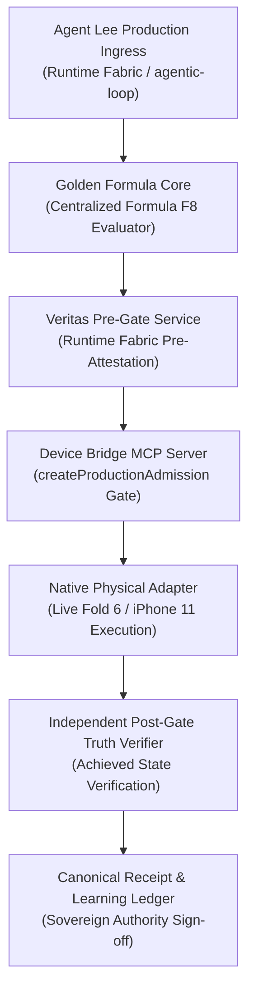

# C3 Independent Canonical Chain Diagnosis and Engineering Direction — 2026-10-14

## Identity
- **WHO**: Agent Lee / Veritas Independent Auditor
- **WHAT**: Formal diagnosis of candidate execution harness (`c3-canonical-execution-chain.mjs`), explicit withholding of canonical approval, preservation of physical device observations, and specification of the required canonical Runtime Fabric connection.
- **WHERE**: `4citeB4U/LEEWAY-DEVICE-BRIDGE` local checkout at `E:\LeeWay-Work\device-bridge-c34-build`
- **WHY**: A local test harness that generates development-key signatures, evaluates a local Boolean function, and calls compliance policies in isolation does not establish the canonical Runtime Fabric → Golden Formula → Veritas → Device Bridge authority chain.
- **HOW**: Strict architectural audit, reclassification of receipt and Learning Ledger artifacts to candidate assessment status, and alignment with Agent Lee's production governance requirements.

---

## The Architectural Diagnosis

1. **Self-Contained Test Harness vs Canonical Production Ingress**:
   - `operator/c3-canonical-execution-chain.mjs` constructed its own execution loop rather than receiving commands from Agent Lee's production request path in Runtime Fabric (`agentic-loop` / `automation-runtime`).
   - It created its own signed consent tokens using a local development key (`dev-key.pem`), which does not prove live sovereign owner consent issuance.
2. **Local Boolean Logic vs Centralized Golden Formula**:
   - The local helper `evaluateFormulaF8` is a local Boolean logic check ($Fire = T \cdot G \cdot \prod C$), not the centralized Golden Formula evaluator running in the Runtime Fabric (`machine-consciousness/domain-policy/formula-domain-policy-core.mjs` / `leeway-formula-v1.mjs`).
3. **General Compliance vs Device-Command Veritas Service**:
   - Calling `runValidationPolicy()` from `ValidationPolicy.ts` confirms structural schema compliance, but does not substitute for the full Runtime Fabric device-command pre/post governance service.
4. **Post-Gate Scope**:
   - The harness verified basic return shape and platform properties, which falls short of independent post-gate verification that proves the operational result was actually achieved in physical reality.
5. **Artifact Reclassification**:
   - [`receipts/LDB-C3-CANONICAL-EXECUTION-QUALIFICATION-20261014.json`](file:///E:/LeeWay-Work/device-bridge-c34-build/receipts/LDB-C3-CANONICAL-EXECUTION-QUALIFICATION-20261014.json) and [`evidence/learning-ledger/LDB-C3-LEARNING-SEVEN-STAGE-EXECUTION-20261014.json`](file:///E:/LeeWay-Work/device-bridge-c34-build/evidence/learning-ledger/LDB-C3-LEARNING-SEVEN-STAGE-EXECUTION-20261014.json) have been formally reclassified to **CANDIDATE ASSESSMENT EVIDENCE**.
   - Canonical approval is **EXPLICITLY WITHHELD**.

---

## What Is Proven & Retained

1. **Fail-Closed Production Entrypoint**:
   - Permissive admission in [`apps/desktop/mcp-server.mjs`](file:///E:/LeeWay-Work/device-bridge-c34-build/apps/desktop/mcp-server.mjs) is replaced with `createProductionAdmission(devices)`, which fails closed on every command dispatch.
   - Verified via real SDK stdio child-process tests (`npm run test:mcp`: 15/15 PASS).
2. **Physical Hardware Observations**:
   - Live Android (Samsung Galaxy Z Fold 6, serial `RFCX70LNT7X`, model `SM-F956U`) successfully read via ADB; verified `industries.leeway.pocket` active.
   - Live Apple (iPhone 11, hardware ID `00008030000C718C0E33402E`) successfully read via Windows PnP CIM/WMI without USB driver modification.
3. **Anti-Replay Durability**:
   - Persistent restart-safe ReplayGuard backed by append-only JSONL ledger.
4. **Regression Integrity**:
   - All 41 repository tests pass (`node --test tests/*.test.mjs`: 41/41 PASS).

---

## Required Correction & Next Acceptance Gate

The next engineering phase must originate from Agent Lee's actual production request path:

1. **Origin**: Ingress must come from Agent Lee's production request path in Runtime Fabric.
2. **Authority**: Replace local token generation with real carrier request authority and enrolled owner consent.
3. **Evaluation**: Connect command eligibility to the centralized Golden Formula engine.
4. **Attestation**: Connect to the production Veritas device-command pre/post service.
5. **Post-Gate**: Perform an independent operational truth read-back verifying actual physical state achieved.
6. **Ledger**: Pass through the canonical receipt and Learning Ledger authorities only after end-to-end verification.

---

## Master Status
- **Device discovery & read-only physical experiments**: ADVANCED & OBSERVED.
- **Fail-closed production entrypoint**: VERIFIED IN LOCAL SOURCE.
- **Full governed Agent Lee execution system**: UNFINISHED.
- **Protected worktree**: Android 6 modified Kotlin files + 12 `.bak` files preserved untouched. Zero git commits, zero git pushes.

RECEIPT NOT CREATED; LEARNING LEDGER NOT UPDATED.
