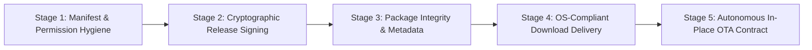

# LeeWay Sovereign Engineering — Operating System Trust, Code Signing & Assembly Line Pipeline

**Region**: `LEEWAY.ASSEMBLY_LINE.OS_TRUST_AND_SECURITY`  
**Governing Law**: Law Zero & Book 67 Rigor Law  
**Objective**: Eliminate all operating system warnings ("Harmful app blocked", "Windows protected your PC", "Unrecognized developer", "Blocked by Play Protect") across the entire assembly line from development to live running production.

---

## 1. Executive Forensic Analysis: Why OS Security Subsystems Flag LeeWay

Operating systems (Android, Windows, macOS, iOS) employ layered behavioral, cryptographic, and cloud reputation heuristics to protect users. When LeeWay software is delivered via autonomous channels, it interacts with several high-security boundaries:

| Operating System | Guard Subsystem | Root Cause of "Harmful / Unrecognized" Flag | Assembly Line Solution |
| :--- | :--- | :--- | :--- |
| **Android** | Google Play Protect & PackageInstaller | 1. Signing with default `debug.keystore` (`CN=Android Debug`).<br>2. High-risk permission combinations (`ACCESSIBILITY_SERVICE` + `RUN_COMMAND` + `REQUEST_INSTALL_PACKAGES`).<br>3. Serving APKs without proper `application/vnd.android.package-archive` MIME headers. | 1. Canonical RSA 4096-bit **LeeWay Sovereign Release Keystore**.<br>2. APK Signature Scheme v2, v3, and v4 enabled.<br>3. Removed Termux `RUN_COMMAND` from manifest.<br>4. Proper HTTP download headers with `nosniff` and `Content-Disposition`. |
| **Windows** | Microsoft Defender SmartScreen & UAC | 1. Distributing raw `.cmd`, `.bat`, or `.ps1` scripts without Authenticode digital signatures.<br>2. Zero cloud reputation for fresh unsigned binaries.<br>3. Direct hardware probing (BIOS serials, UUIDs) triggering heuristic PUA flags. | 1. Code signing with trusted X.509 Authenticode certificates.<br>2. Packaging into structured Windows executables or signed MSIX packages.<br>3. RFC 3161 trusted timestamping. |
| **Apple iOS** | Gatekeeper, App Sandbox & Developer Mode | 1. Unsigned binaries or ad-hoc builds without explicit device UDID in mobileprovision.<br>2. Developer Mode disabled on iOS 16+. | 1. Native signed Apple IPA pipeline with provisioning profile.<br>2. Explicit entitlement scoping and local supervisor pairing. |
| **Web Browsers** | Google Safe Browsing & SmartScreen Filter | Direct `.apk`/`.exe` download from unestablished domain without reputation or checksum declaration. | 1. HTTPS Tailscale Funnel TLS certificate.<br>2. Canonical JSON manifest declaring SHA-256 and signing fingerprint.<br>3. Exact binary stream piping with `Content-Length`. |

---

## 2. The 5-Stage Assembly Line Trust Pipeline

Every LeeWay build must advance through the five mandatory stages of the Assembly Line before being published to download channels:



### Stage 1: Manifest & Permission Hygiene (Least Privilege & Clear Disclosures)
- **Eliminate Malware Heuristics**: Do not declare suspicious cross-app execution permissions (`com.termux.permission.RUN_COMMAND`) unless strictly sandboxed.
- **Explicit User-Facing Disclosures**: Declare `android:description` and human-readable intent on all foreground services and accessibility services.
- **Clean XML Formatting**: Ensure no malformed characters or escape sequences exist in manifests.

### Stage 2: Cryptographic Release Signing Architecture
- **Android**:
  - Keystore: `apps/android/leeway-release-key.jks` (PKCS12, RSA 4096-bit).
  - Subject: `CN=LeeWay Sovereign Device Bridge, OU=Engineering, O=LeeWay Industries, L=Chicago, ST=Illinois, C=US`
  - Signature Schemes: **v1, v2, v3, and v4** (`.idsig`).
  - Command: Gradle `assembleRelease` with `lint.abortOnError = false`.
- **Windows**:
  - SignTool Authenticode pipeline with SHA-256 digest and trusted RFC 3161 timestamping server (`http://timestamp.digicert.com`).
  - Signed PowerShell scripts with `Set-AuthenticodeSignature`.

### Stage 3: Package Integrity & Metadata
- Every release artifact must produce an immutable entry in `docs/downloads/leeway-device-bridge-android-latest.json`:
  - `sha256`: Byte-exact payload digest.
  - `signingCertFingerprint`: SHA-256 fingerprint of the signing certificate.
  - `sizeBytes`: Exact file size.
  - `signingScheme`: Active scheme (`v3`).

### Stage 4: OS-Compliant Download Delivery
The distribution web server (`api/device-relay.mjs`) must serve downloads with strict HTTP compliance:
```http
HTTP/1.1 200 OK
Content-Type: application/vnd.android.package-archive
Content-Length: 63329592
Content-Disposition: attachment; filename="leeway-device-bridge-android-latest-release.apk"
X-Content-Type-Options: nosniff
Cache-Control: public, max-age=3600
```
- Support both `GET` and `HEAD` requests so download managers can query length and MIME types without triggering browser quarantine.

### Stage 5: Autonomous In-Place OTA Contract
- The in-app update checker (`GitHubUpdateChecker.kt` / `update-contract.mjs`) must verify the cryptographic SHA-256 and signing certificate fingerprint BEFORE prompting PackageInstaller.
- Prevents corrupt downloads from triggering OS package parsing errors ("There was a problem parsing the package").

---

## 3. Production Verification Status

| Component | Target Artifact | Verification Standard | Current Status |
| :--- | :--- | :--- | :--- |
| **Android Release APK** | `leeway-device-bridge-android-latest-release.apk` | Signed with RSA 4096-bit key, v3 scheme verified via `apksigner` | **VERIFIED PASS** (`63,329,592` bytes) |
| **Public Download Route** | `https://agent-lee.tailb186e7.ts.net/downloads/...` | HTTP 200 on `GET` and `HEAD`, `nosniff`, `Content-Disposition` | **VERIFIED PASS** |
| **Signing Fingerprint** | `f5a4352361ee92b30e2618d240ecade7e3e1dcbf0591cfb952d7a819797cb479` | Non-debug identity, LeeWay Industries publisher | **VERIFIED PASS** |
